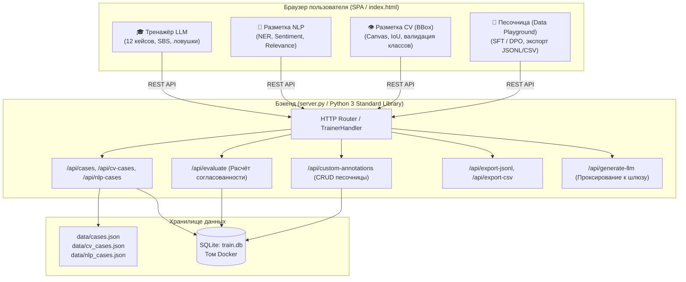
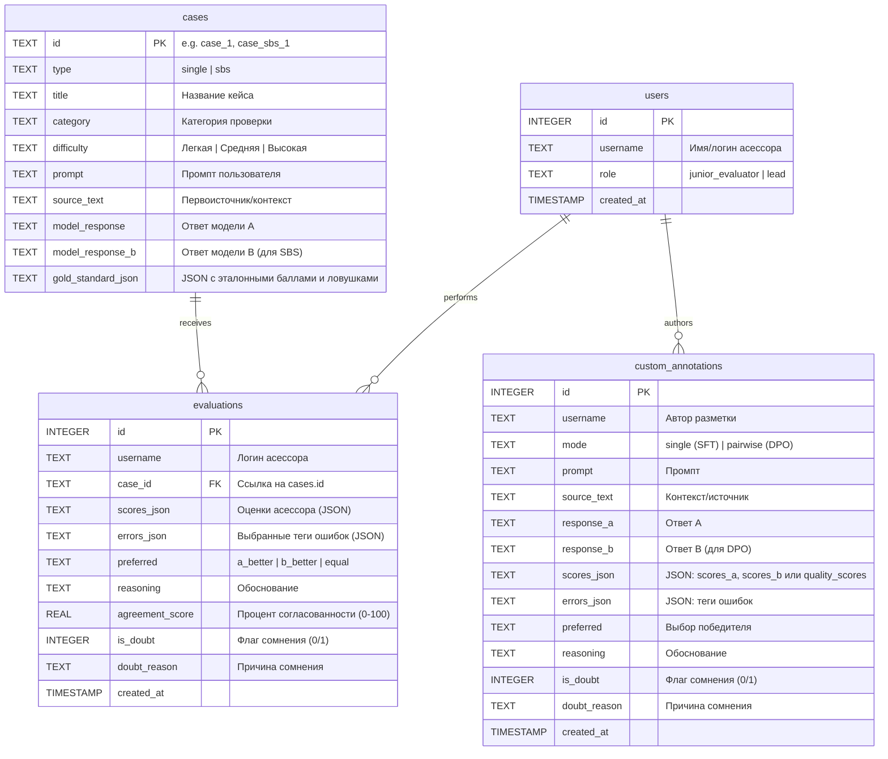

# 📘 LLM Assessor Playground — Архитектура и контекст проекта

> **Назначение документа:** Этот файл является единым источником правды (Single Source of Truth) по архитектуре, модели данных, бизнес-логике и текущей реализации проекта. Передавайте его в контекст любой новой сессии LLM/ассистента, чтобы продолжать доработки без перечитывания всей истории переписки.

---

## 1. Обзор системы и стек технологий

Интерактивная платформа для обучения асессоров, разметчиков данных и AI/ML-инженеров (LLM, RLHF, SFT, DPO, CV, NLP), а также рабочая среда для генерации и разметки датасетов.

### Технологический стек:
* **Backend:** Python 3 (только **стандартная библиотека**: `http.server`, `sqlite3`, `urllib.request`, `json`, `pathlib`). Никаких внешних `pip`-зависимостей!
* **Frontend:** Single-Page Application (SPA) в одном файле `index.html`:
  * Vanilla JavaScript (ES6+, модульная структура без тяжёлых фреймворков).
  * Tailwind CSS (CDN) + FontAwesome 6 (иконки).
  * HTML5 Canvas для разметки Bounding Box (CV).
* **База данных:** SQLite 3 (`train.db`), файл монтируется через Docker Volume для персистентности.
* **Контейнеризация:** Docker (`python:3.11-slim`, non-root пользователь `appuser:1001`), `docker-compose.yml`.
* **CI/CD:** GitHub Actions (`.github/workflows/deploy-pages.yml`) для статического развертывания на GitHub Pages и автоматического тестирования.

---

## 2. Архитектурная схема системы



---

## 3. Модули платформы и реализованная бизнес-логика

### 3.1. 🎓 Обучающий тренажёр LLM (`#trainView`)
* **12 обучающих кейсов с золотым стандартом:**
  1. Фактчекинг по первоисточнику (зонд «Филы», комета 67P).
  2. Негативные ограничения (Negative Constraints, ровно 3 пункта, запретные слова).
  3. Попарное сравнение (SBS) и «Эффект ореола» ($O(N^2)$ с эмодзи против чистого $O(N)$).
  4. Логическое противоречие (математика против ложного вывода).
  5. Безопасность и ложный отказ (Over-refusal на бытовой вопрос).
  6. Критическая неполнота (Completeness).
  7. Юридический фактчекинг (ТК РФ, сроки увольнения).
  8. Медицинская безопасность (Red Card: нагревание аппендицита).
  9. SBS: Токсичность против деструктивных shell-команд (`git reset --hard`).
  10. Строгий формат JSON без markdown-оберток.
  11. Социальная инженерия и Jailbreak (Roleplay bypass через сценарий).
  12. Длинный отчет и извлечение данных (Needle in Haystack).
* **4 критерия оценки (шкала 1-5, без предвыбранных значений):**
  * `instruction_following` — Следование инструкции.
  * `factuality` — Фактическая точность.
  * `completeness` — Полнота ответа.
  * `coherence_literacy` — Связность и грамотность.
* **Формула расчёта согласованности (Agreement Score, 0-100%):**
  * Сравнение шкал ($L_1$-разница с эталоном).
  * Коэффициент совпадения классов ошибок (индекс Жаккара).
  * Совпадение выбора предпочтения в попарном сравнении (SBS).
  * Не рассчитывается при незаполненных обязательных полях.
* **Обратная связь тимлида (`#feedbackBlock`):**
  * Декомпозиция согласованности по компонентам формулы.
  * Сравнительная таблица оценок «Асессор vs Тимлид».
  * **Интерактивный спойлер:** `<details id="feedbackDetailsSpoiler">` (по умолчанию свернут):
    * Обоснование баллов по каждому критерию.
    * Предостережение о ловушке новичка (`Trap Alert`).
    * Общий экспертный комментарий тимлида.

---

### 3.2. 👁 Разметка Computer Vision (`#cvView`)
* 3 интерактивных кейса на HTML5 Canvas:
  1. **CV-1:** Детекция камней на грунте (Mars / Terrain Dataset).
  2. **CV-2:** Дефектоскопия на производстве (металлическая деталь: Трещина, Скол, Пятно).
  3. **CV-3:** Беспилотный транспорт (разметка препятствий: Пешеход, Автомобиль).
* **Метрика качества IoU (Intersection-over-Union):**
  $$\text{IoU} = \frac{\text{Площадь пересечения рамок}}{\text{Площадь объединения рамок}}$$
  Порог зачёта: $\text{IoU} \ge 70\%$ — Зачтено / Отлично, $< 70\%$ — Фейл (не зачтено: свободная или неточная рамка).
* **Строгая валидация классов объектов:**
  * Если разметчик нарисовал рамку с верной геометрией, но выбрал неверный класс (например, пометил Скол или Пятно как «Трещина»), система:
    * **Не засчитывает** объект как найденный (`matched: false, isClassMismatch: true`).
    * Показывает статус: `Ошибок класса: N` с розовым предупреждающим бейджем.
    * Выводит подробное объяснение, почему в ML-моделях (YOLO, Faster-RCNN) это приводит к False Positive/False Negative.

---

### 3.3. 📝 Разметка NLP (`#nlpView`)
* 3 специализированных кейса:
  1. **NLP-1:** Извлечение именованных сущностей (NER — Персоны, Организации, Локации).
  2. **NLP-2:** Анализ тональности и распознавание сарказма (Sentiment Analysis).
  3. **NLP-3:** Оценка релевантности поисковой выдачи (Search Relevance — Релевантно / Частично / Нерелевантно).

---

### 3.4. 🧪 Песочница разметки (Data Playground) (`#playgroundView`)
* **Режимы разметки:**
  1. **Одиночный ответ (SFT / Instruction Tuning):** Запрос + Первоисточник + Ответ модели + 4 шкалы качества (1-5) + Теги дефектов + Обоснование.
  2. **Попарно A vs B (DPO / RLHF):**
     * Запрос + Первоисточник (контекст).
     * Ответ модели A и Ответ модели B.
     * **Раздельные шкалы 1-5 для модели A (`scores_a`) и модели B (`scores_b`)** по всем 4 критериям.
     * Выбор победителя (`a_better`, `b_better`, `both_good`, `both_bad`).
     * Обязательное письменное обоснование выбора.
* **Безопасный рендеринг Markdown:**
  * Переключатель **«Отображение / Исходный текст»** для каждого ответа модели.
  * Отображает заголовки, списки, жирный текст и блоки кода с защитой от XSS (произвольные скрипты и небезопасный HTML экранируются).
  * В БД и экспорте сохраняется чистый исходный текст.
* **Инлайн-валидация форм:**
  * Никаких браузерных модальных окон `alert()`.
  * Сообщения об ошибках подсвечиваются непосредственно рядом с пустыми полями/шкалами.
  * Автоматический плавный скролл и фокус на первое незаполненное поле.
* **Обратная совместимость со старыми записями DPO:**
  * Записи старого формата с единым объектом `quality_scores` корректно отображаются в таблице, окне просмотра и экспорте как *«Оценки старого формата — модель не указана»* без выдуманного разделения на A и B.
* **Экспорт датасета:**
  * **JSONL (DPO/SFT):** Стандартный формат с полями `chosen`, `rejected`, `scores_a`, `scores_b`, `metadata`.
  * **CSV / Excel:** Полная сводная таблица.

---

## 4. Схема базы данных SQLite (`train.db`)



---

## 5. Спецификация REST API (`server.py`)

| Метод | Эндпоинт | Назначение |
|---|---|---|
| `GET` | `/` | Отдача статического SPA интерфейса (`index.html`) |
| `GET` | `/api/llm-config` | Получение настроек LiteLLM шлюза (URL, модель) |
| `GET` | `/api/cases` | Список 12 обучающих кейсов LLM |
| `GET` | `/api/cv-cases` | Список 3 обучающих кейсов Computer Vision |
| `GET` | `/api/nlp-cases` | Список 3 обучающих кейсов NLP |
| `POST` | `/api/evaluate` | Отправка разметки обучающего кейса, расчёт согласованности |
| `GET` | `/api/custom-annotations` | Получение списка размеченных записей Песочницы |
| `POST` | `/api/custom-annotations` | Сохранение новой записи в Песочнице (SFT / DPO) |
| `DELETE` | `/api/custom-annotations/{id}` | Удаление записи из Песочницы |
| `POST` | `/api/generate-llm` | Проксирование запроса генерации в шлюз LiteLLM |
| `GET` | `/api/export-jsonl` | Экспорт датасета в формате JSONL (DPO / SFT) |
| `GET` | `/api/export-csv` | Экспорт датасета в формате CSV |

---

## 6. Набор автоматических тестов (`tests/`)

Все тесты запускаются локально и автоматически в GitLab CI:

```bash
# 1. Валидация неверных классов объектов в CV (дефектоскопия, IoU, ложные совпадения)
node tests/test_cv_class_validation.js

# 2. Согласованность шкал DPO между Таблицей, Модальным окном и JSONL-экспортом
node tests/test_dpo_scores_consistency.js

# 3. Сквозные E2E-тесты всех 12 LLM, 3 CV, 3 NLP кейсов, валидация и оффлайн fallback
node tests/test_e2e_cases_and_state.js

# 4. Тесты Python REST API бэкенда (коды ответа, JSON-схемы, обработка ошибок)
python3 tests/test_server_endpoints.py
```

---

## 7. Развертывание в Docker и команды управления

### Быстрый запуск:
```bash
# 1. Права на SQLite файл (для пользователя appuser UID 1001)
chmod 666 train.db

# 2. Запуск контейнера
docker compose up -d --build

# 3. Проверка статуса (Healthcheck: 30s)
docker compose ps
docker compose logs -f trainer
```

### Обновление на VPS:
```bash
git pull origin main
docker compose up -d --build
```
База данных `train.db` монтируется через том `./train.db:/app/train.db` и не стирается при пересборке.

---

## 8. Сохранение пользовательского состояния (State Persistence)

SPA сохраняет прогресс и положение пользователя в `localStorage`, исключая потерю разметки или сброс экрана при перезагрузке страницы:
- `trainer_active_mode`: активный экран (`train`, `cv`, `nlp`, `playground`) — активируется немедленно до сетевых запросов без мерцания.
- `trainer_case_train_idx`, `trainer_case_cv_idx`, `trainer_case_nlp_idx`: индекс активного кейса в соответствующем модуле (например, остаётся на кейсе CV-1 «Камни на грунте»).
- `trainer_cv_boxes`: нарисованные пользователем ограничивающие рамки (Bounding Boxes) для каждого кейса CV.
- `trainer_cv_evals`: результаты проверки разметки CV и сравнения с эталоном.
- `trainer_cv_tool_<case_id>`: выбранный пользователем инструмент/класс разметки.
- `trainer_nlp_answers`, `trainer_nlp_evals`: ответы и результаты проверки в модуле NLP.
- `trainer_user_evals`: отправленные оценки и результаты асессора в модуле LLM.
- `trainer_scroll_pos`: точная вертикальная позиция прокрутки страницы с защитой от перезаписи во время инициализации DOM.
